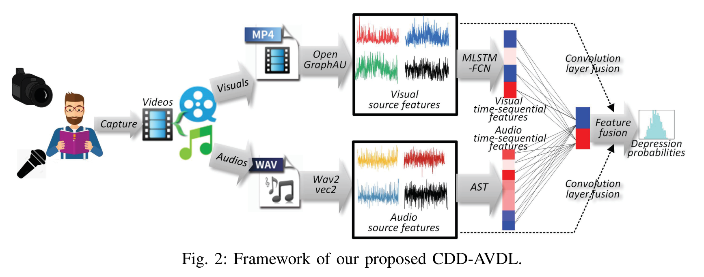
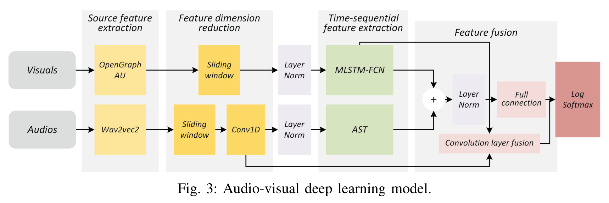
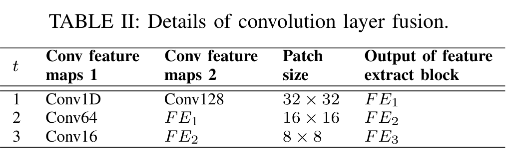
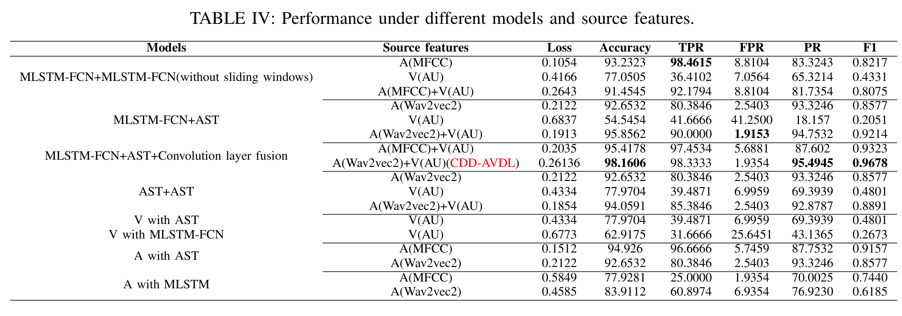
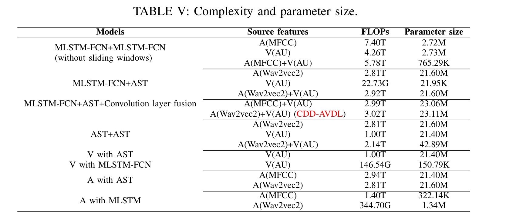
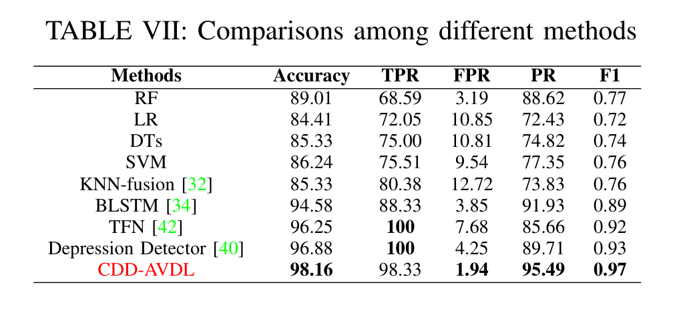

# CDD-AVDL

Reference implementation of

> **Catching the Blackdog Easily: A Convenient Depression Diagnosis Method based
> on Audio-Visual Deep Learning**
> Linfeng Liu, Sitan Chen, Kejia Chen, Jiajun Xu, Xiacan Chen
> *IEEE Transactions on Affective Computing*, 2025
> DOI: [10.1109/TAFFC.2025.3571697](https://doi.org/10.1109/TAFFC.2025.3571697)

CDD-AVDL diagnoses depression from a short audio-visual recording in which the
participant reads a fixed text. Audio is encoded with wav2vec2 and AST, visual
facial action units are encoded with MLSTM-FCN, and the three MLSTM-FCN
convolution blocks are fused with the audio sequence in three convolution
stages before classification.

## Highlights

- **Every width is derived.** The released code hard-codes 1190, 7161, 1192,
  73, 147, 296 and 512. Here they follow from two measured sequence lengths, so
  the same model runs on any corpus without editing source.
- **Numerically identical to the released implementation.** The test suite
  transplants the reference weights and asserts equal log-probabilities.
- **Configuration, not constants.** Model, data and training settings live in
  YAML; nothing is edited in place.
- **Portable.** No timm version pin, no global monkey patching, no forced
  autocast, no Windows-only dependency.

## Architecture

<em>Fig. 2 of the paper: the overall pipeline, from capture to the depression probability.</em>

<em>Fig. 3 of the paper: the four stages implemented under cdd_avdl/models, with the two feature streams kept separate until the fusion block.</em>

    audio   (B, Ta, 768)                       visual  (B, Tv, 41)
        |                                          |
    Conv1d(768 -> 64, k=2)                     MLSTM-FCN
        |  (B, Ta-1, 64)                           |  three conv blocks
    LayerNorm                                      |  (B,128,L1) (B,64,L2) (B,32,L3)
        |                                          |  + LSTM head -> 4 features
    AST (patch 16, stride 10)                      |
        |  -> 8 audio features                     |
        |                                          |
        +----------> convolution-layer fusion <----+
                     stage 1  patch 32  -> 73 channels
                     stage 2  patch 32  -> 147 channels
                     stage 3  patch 8   -> 296 channels -> 8 -> 512
                              |
                     Linear(512 -> 2)
                              |
                     early fusion (Eq. 4)
                     log_softmax((y_fusion + y_features) / 2)
                              |
                        class log-probabilities

For the paper geometry (Ta = 1193, Tv = 7168) the derived widths are:

| quantity | value |
| --- | --- |
| audio length after Conv1d | 1192 |
| AST patch grid | 5 x 118 = 590 patches |
| MLSTM-FCN block lengths | 7161 / 7157 / 7155 |
| fusion stage channels | 73 / 147 / 296 |
| fusion feature width | 512 |
| early-fusion feature width | 12 |
| parameters | 24,106,680 |

See [docs/architecture.md](docs/architecture.md) for the full derivation.

The three fusion stages follow TABLE II of the paper. The patch sizes and the
channel counts listed there are not constants in this code: Patchify and
ConvLayerFusion derive them from the channel count and the sequence length of
whatever features they are given, which is why the same model definition also
runs on DAIC-WOZ and EATD-Corpus.

## Installation

    git clone https://github.com/cstcood/CDD_AVDL.git
    cd CDD_AVDL
    python -m venv .venv
    .venv\Scripts\activate          # Windows
    source .venv/bin/activate        # Linux and macOS
    pip install -r requirements.txt
    pip install -e .

Python 3.9 or newer and PyTorch 2.0 or newer are required. A GPU is recommended
but not required.

## Quick start

    # 1. describe the model for a pair of sequence lengths
    python -c "from cdd_avdl.models.cdd_avdl import CDDAVDL; import json; print(json.dumps(CDDAVDL.from_example(1193, 7168).describe(), indent=2, default=str))"

    # 2. train one fold
    python scripts/train.py --config configs/default.yaml --fold 0

    # 3. train all five folds
    python scripts/train.py --config configs/default.yaml --cross-validate

    # 4. evaluate a checkpoint
    python scripts/evaluate.py --config configs/default.yaml --checkpoint runs/default/best.pt

    # 5. run the tests
    python -m pytest tests -q

## Data

The model consumes pre-extracted features:

    data/
      labels.csv                 sample_id,label[,fold]
      audio/<sample_id>.npy      float32, (T_audio, 768)
      visual/<sample_id>.npy     float32, (T_visual, 41)

Only two numbers have to be measured from the corpus: data.audio_len and
data.visual_len. Everything else is derived. See [docs/data.md](docs/data.md)
for the extraction pipeline and for the constraints the configuration enforces.

## Dataset availability

The corpus used in the paper was recorded at the Mental Health Center, West
China Hospital, Sichuan University: 413 participants (103 diagnosed with
depression, 310 non-depressed), each reading the same 17-sentence,
617-character text, with recordings of 105 to 238 seconds.

**The corpus is not redistributed with this repository.** It contains clinical
recordings of identifiable participants and is governed by the ethics approval
and the data-sharing agreement of the recording institution, so it cannot be
published alongside the code.

**Use is restricted to academic research.** The data-sharing agreement permits
academic, non-commercial research only. Commercial use, product development,
clinical deployment, and any further redistribution of the recordings or of
features derived from them fall outside the agreement and are not granted by
it. This restriction applies to the corpus, not to the code in this
repository, which is released under the MIT license.

Access requests are handled by the recording institution, not by the repository
maintainers. Direct them to the Mental Health Center, West China Hospital,
Sichuan University, and refer to the corresponding author listed on the first
page of the paper. A request normally states the applicant institution, the
academic research purpose the data would serve, the applicant's own ethics
approval or IRB reference, and the expected duration of the collaboration.

If the clinical corpus is not available to you, the two public corpora
configured in this repository (DAIC-WOZ and EATD-Corpus) use the same two
feature streams and run without any code change.

## Configuration

Three YAML files are provided:

| file | corpus |
| --- | --- |
| configs/default.yaml | the paper geometry, Ta = 1193, Tv = 7168 |
| configs/daic_woz.yaml | DAIC-WOZ |
| configs/eatd_corpus.yaml | EATD-Corpus |

Any field can be overridden from the command line:

    python scripts/train.py --config configs/default.yaml --epochs 50 --batch-size 4 --device cpu

or from Python:

    from cdd_avdl.config import Config
    from cdd_avdl.models.cdd_avdl import CDDAVDL

    config = Config.from_yaml("configs/default.yaml")
    config.data.audio_len = 1500
    config.data.visual_len = 900
    model = CDDAVDL(config)
    print(model.describe())

## Repository layout

    cdd_avdl/
      config.py              dataclass configuration with YAML round-trip
      factory.py             build models and dataloaders from a Config
      models/
        ast.py               AST with a per-instance patch embedding
        mlstm_fcn.py         MLSTM-FCN with derived block lengths
        fusion.py            patchification and the three fusion stages
        cdd_avdl.py          the full network
      data/
        dataset.py           feature dataset, label parsing, fold splitting
        features.py          wav2vec2 and OpenGraphAU extractors
      engine/
        train.py             training loop, evaluation, cross validation
        metrics.py           accuracy, TPR, FPR, precision, recall, F1
      utils/seed.py          reproducibility helpers
    scripts/                 train, evaluate, extract_features
    configs/                 YAML configurations
    docs/                    architecture, data, reproduction
    tests/                   shape tests and reference-equivalence tests
    assets/                  figures and tables reproduced from the paper

## Results

The paper reports, on the West China Hospital corpus (413 participants, 103
depressed and 310 non-depressed, five-fold cross validation):

| metric | value |
| --- | --- |
| Accuracy | 98.16 % |
| TPR | 98.33 % |
| FPR | 1.9354 % |
| PR | 95.4945 % |
| F1 | 0.9678 |
| parameters | 23.11 M |

### Performance under different models and source features

<em>TABLE IV of the paper. The last row of the audio-visual group is CDD-AVDL.</em>

### Complexity and parameter size

<em>TABLE V of the paper. The 23.11 M quoted above is the A(Wav2vec2)+V(AU) row. Building the same geometry here gives 24.11 M, a gap of about 1.0 M that sits in the AST branch: it accounts for 22.39 M of the total and is the only part whose size depends on the configured patch grid, while the paper does not state the full AST configuration. The fusion block contributes 1.51 M, the Conv1d and MLSTM-FCN branches 0.10 M each.</em>

### Comparisons among different methods

<em>TABLE VII of the paper: CDD-AVDL against classical classifiers and against the audio-visual baselines.</em>

## Differences from the released code

The refactor preserves the computation exactly; tests/test_equivalence.py
asserts a maximum absolute difference of zero on the log-probabilities. Four
non-numerical changes were made:

1. The fourth ReLU is named relu4 instead of reusing relu3. Both are
   parameter-free, so no value changes.
2. The timm version assertion and the global PatchEmbed monkey patch are gone;
   the patch embedding is replaced on the instance, and both timm 0.4.x and
   1.x module names are accepted.
3. The autocast decorator on ASTModel.forward is removed; precision is decided
   by the training loop.
4. patch_concat.chanel_out, which was computed incorrectly and never used, is
   replaced by a correct out_channels.

## Contact

| topic | where to go |
| --- | --- |
| dataset request, clinical collaboration | the recording institution, see Dataset availability |
| model, code, paper | the corresponding author listed on the first page of the paper |
| bug reports and pull requests | open an issue on this repository |

## Citation

    @article{liu2025cddavdl,
      title   = {Catching the Blackdog Easily: A Convenient Depression Diagnosis
                 Method based on Audio-Visual Deep Learning},
      author  = {Liu, Linfeng and Chen, Sitan and Chen, Kejia and Xu, Jiajun
                 and Chen, Xiacan},
      journal = {IEEE Transactions on Affective Computing},
      year    = {2025},
      doi     = {10.1109/TAFFC.2025.3571697}
    }

A machine-readable record is provided in [CITATION.cff](CITATION.cff).

## License

MIT for the code. See [LICENSE](LICENSE).

The license covers this repository only. It does not extend to the clinical
corpus, which is not distributed here and whose data-sharing agreement permits
academic, non-commercial research use only, nor to the figures and tables under
assets/, which remain copyright IEEE.
